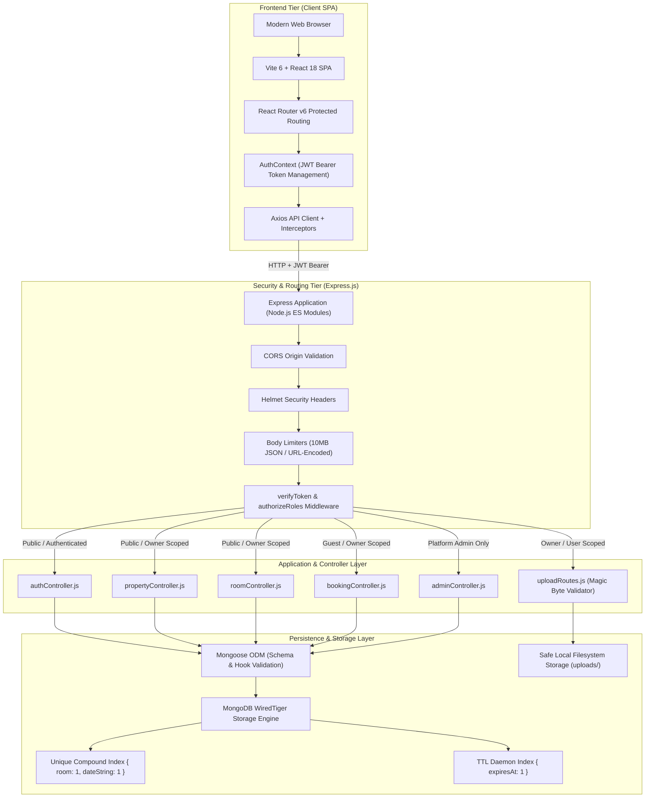
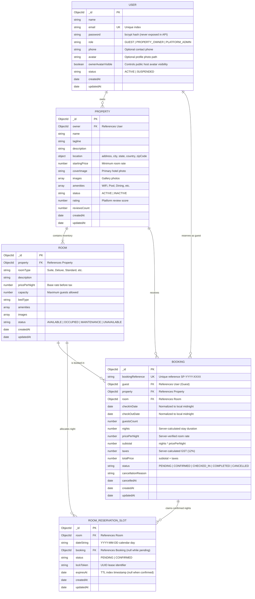
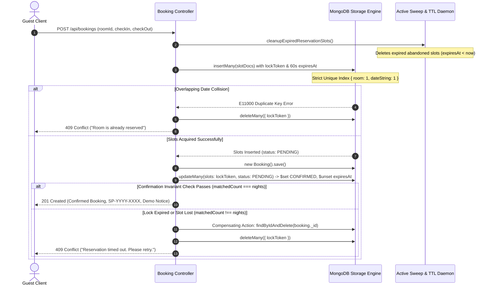

# StayPulse System Architecture & Data Design

This document details the software architecture, database design, role-based authorization matrix, and concurrency safety mechanisms implemented in **StayPulse**.

---

## 1. System Architecture

StayPulse is engineered as a decoupled, multi-tier Single Page Application (SPA) with a RESTful backend API powered by the MERN stack.



---

## 2. Database Relationship Diagram (ERD)

The data model maintains strict multi-tenant boundaries and guarantees atomic calendar reservations across multi-process clusters.



---

## 3. Role & Authorization Matrix

StayPulse enforces three distinct user roles with zero permission bleeding.

| Endpoint / Feature | Method | GUEST | PROPERTY_OWNER | PLATFORM_ADMIN | Unauthenticated |
| :--- | :---: | :---: | :---: | :---: | :---: |
| **Public Hotel Search & Filtering** | `GET /api/properties` | ✅ | ✅ | ✅ | ✅ |
| **Public Room Catalog** | `GET /api/properties/:id/rooms` | ✅ | ✅ | ✅ | ✅ |
| **Room Calendar Availability** | `GET /api/bookings/rooms/:id/availability` | ✅ | ✅ | ✅ | ✅ |
| **Account Registration** | `POST /api/auth/register` | ✅ (Self) | ✅ (Self) | ❌ (Blocked) | ✅ |
| **User Login** | `POST /api/auth/login` | ✅ | ✅ | ✅ | ✅ |
| **View Current Profile** | `GET /api/auth/me` | ✅ | ✅ | ✅ | ❌ (401) |
| **Update Personal Profile** | `PUT /api/auth/profile` | ✅ | ✅ (Can toggle avatar) | ✅ | ❌ (401) |
| **Create Hotel Listing** | `POST /api/properties` | ❌ (403) | ✅ (Auto-assigned) | ❌ (403) | ❌ (401) |
| **Manage Own Properties** | `PUT/DELETE /api/properties/:id` | ❌ (403) | ✅ (Own only) | ❌ (403) | ❌ (401) |
| **Manage Own Rooms** | `POST/PUT/DELETE /api/rooms` | ❌ (403) | ✅ (Own only) | ❌ (403) | ❌ (401) |
| **Book Room Reservation** | `POST /api/bookings` | ✅ | ❌ (403) | ❌ (403) | ❌ (401) |
| **View Own Guest Stays** | `GET /api/bookings/my-bookings` | ✅ (Own only) | ❌ (403) | ❌ (403) | ❌ (401) |
| **Cancel Own Guest Stay** | `PATCH /api/bookings/:id/cancel` | ✅ (Own only) | ❌ (403) | ❌ (403) | ❌ (401) |
| **View Hotel Reservations** | `GET /api/bookings/owner/my-bookings` | ❌ (403) | ✅ (Own hotels) | ❌ (403) | ❌ (401) |
| **Update Stay Status** | `PATCH /api/bookings/owner/:id/status`| ❌ (403) | ✅ (Own hotels) | ❌ (403) | ❌ (401) |
| **Owner Dashboard Analytics** | `GET /api/bookings/owner/analytics` | ❌ (403) | ✅ (Scoped to own) | ❌ (403) | ❌ (401) |
| **Inspect Individual Booking**| `GET /api/bookings/:id` | ✅ (Own only) | ✅ (Own hotels) | ❌ (403 Strict) | ❌ (401) |
| **View Guest Profile Photos**| `GET /api/uploads/profiles/:file` | ✅ (Own photo) | ✅ (Booked guests) | ❌ (403 Strict) | ❌ (401) |
| **Platform System Overview** | `GET /api/admin/overview` | ❌ (403) | ❌ (403) | ✅ (Aggregates) | ❌ (401) |
| **User Oversight & Moderation**| `GET/PATCH /api/admin/users` | ❌ (403) | ❌ (403) | ✅ (Privacy on) | ❌ (401) |
| **Property Moderation** | `GET/PATCH /api/admin/properties` | ❌ (403) | ❌ (403) | ✅ | ❌ (401) |

---

## 4. Booking Concurrency & Orphaned Slot Recovery

### 4.1 Cross-Process Mutual Exclusivity
In multi-core server environments (e.g. Node.js clusters, multiple container replicas), in-memory mutexes (such as `AsyncMutex` or Javascript Map locks) cannot protect against simultaneous overlapping bookings. StayPulse delegates mutual exclusivity directly to **MongoDB's WiredTiger storage engine**:

```javascript
// Enforces zero overlapping date collisions at the storage engine level
roomReservationSlotSchema.index({ room: 1, dateString: 1 }, { unique: true });
```
When two concurrent requests attempt to reserve the same room on the same date string (`YYYY-MM-DD`), WiredTiger atomically allows only one document insertion. The competing process immediately catches an `E11000 Duplicate Key Error` and safely returns HTTP `409 Conflict`.

### 4.2 The Two-Phase Lease-Based Lock Pattern



---

## 5. Standalone MongoDB Limitations & Mitigations

### 5.1 Honest Architectural Boundaries
- **No Multi-Document Transactions**: Standalone MongoDB deployments (without replica set clustering) do not support multi-document ACID transactions (`session.startTransaction()`).
- **The Crash Window**: If an uncatchable catastrophic failure (e.g., `kill -9` or physical server power loss) occurs in the microsecond window **after** `await booking.save()` finishes but **before** `RoomReservationSlot.updateMany()` executes, an unconfirmed `Booking` document could exist in the database with its slots still in `PENDING` status.

### 5.2 Mitigations Implemented
1. **Time-To-Live (TTL) Automatic Reclamation**: The reservation slots are created with a 60-second `expiresAt` lease and an active TTL index (`{ expireAfterSeconds: 0 }`). Both MongoDB's background TTL thread and the application's active pre-check sweep will automatically purge the unconfirmed slots.
2. **Dates Never Permanently Blocked**: Because the slots expire after 60 seconds, calendar dates are never permanently locked, and subsequent booking attempts can safely reserve the room.
3. **Compensating Rollbacks on Recoverable Errors**: For all application-level errors, timeouts, or partial slot losses, the invariant check `updateResult.matchedCount !== nights` automatically deletes the created `Booking` document immediately.
